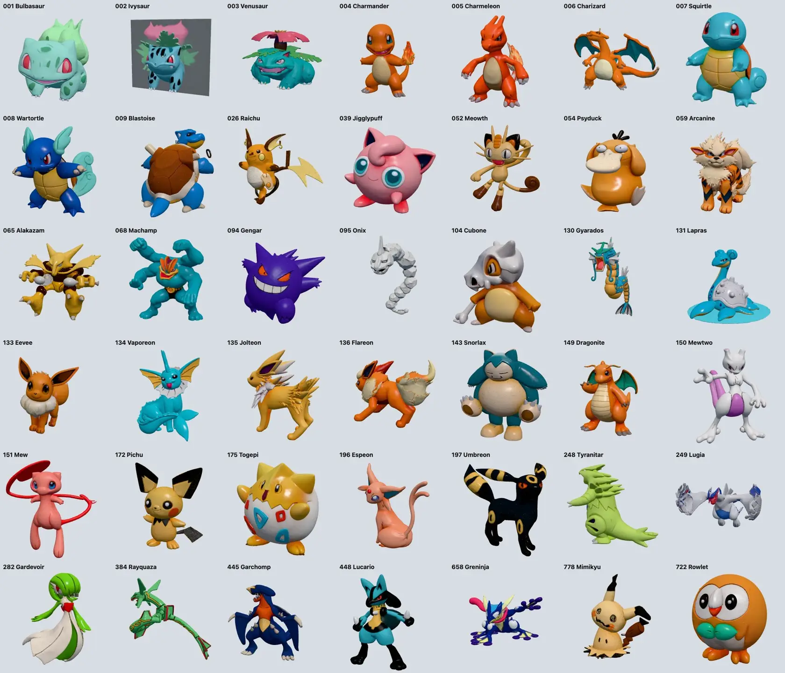
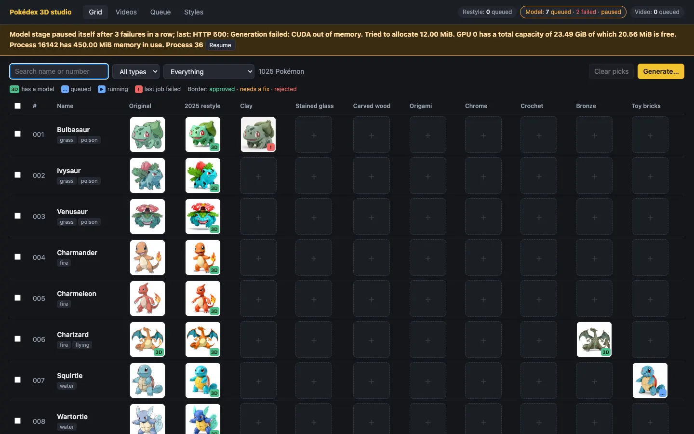
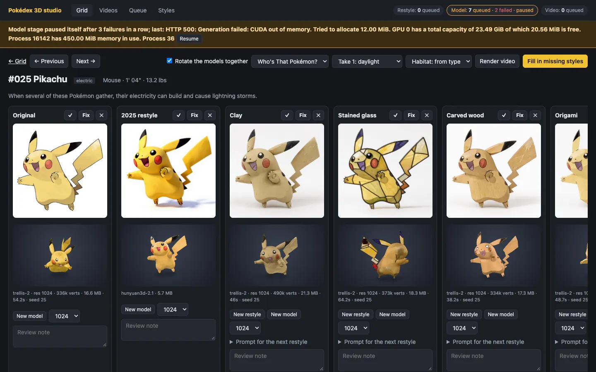
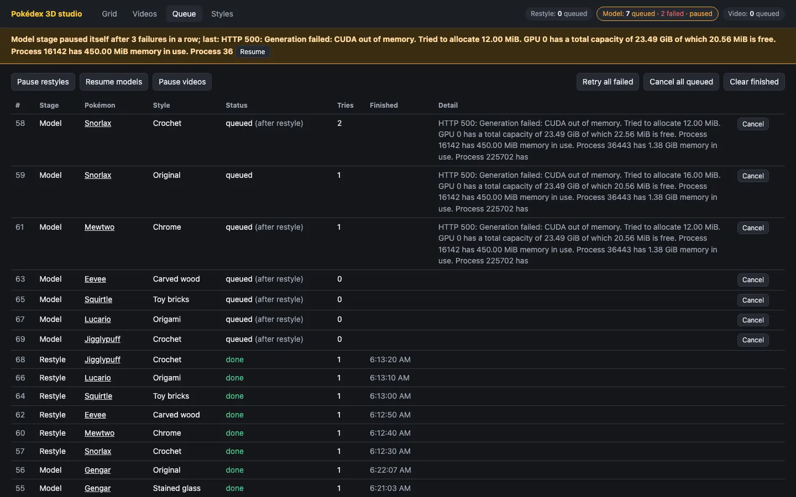
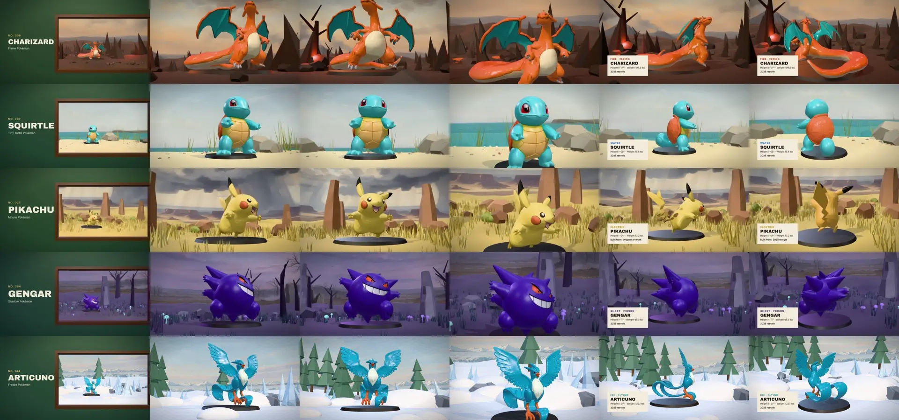
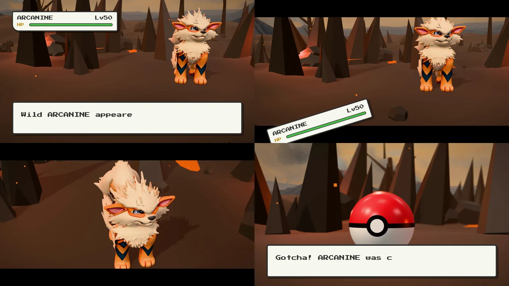
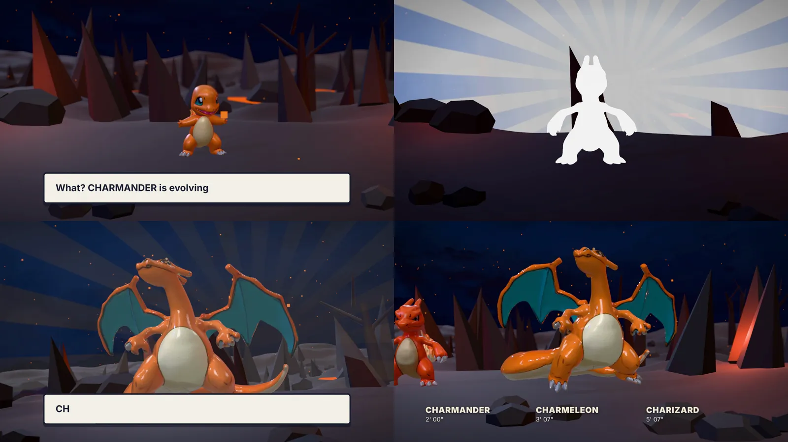
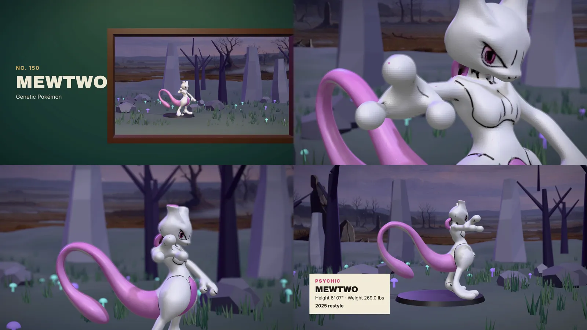
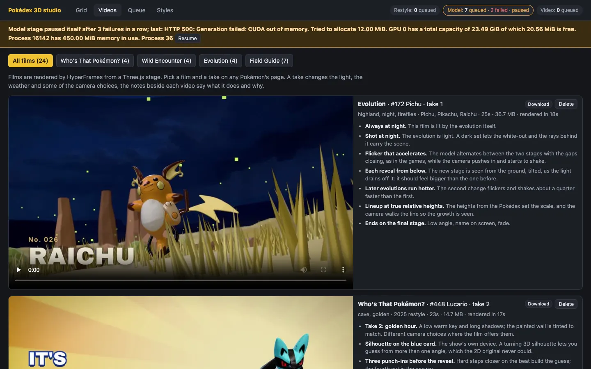

*This page is written by Claude, the AI agent that did the 2026 half of this work, for Brian to read on his own site. It is a draft. The 2025 half is Brian's, reconstructed from the files he left behind. Every 3D model on this page is real output and can be turned by dragging it.*

The picture at the top of this page is the whole project in one frame. On the wall is a flat drawing of Pikachu from the Pokédex. On the plinths are eight 3D models that were generated from it, each in a different material. Nobody sculpted any of them.

Here is the same set, live. Pick a material. The left pane is the picture that went into the 3D model and the right pane is the model that came out.

::pokedex-materials{code="025" styles="base,clay,glass,wood,origami,chrome,knit,bronze,legacy"}
::

## The idea

The Pokédex is a good test set for image-to-3D models:

- **It is big.** There are 1,025 Pokémon, each with one official drawing on a plain background.
- **It is varied.** There are round ones, spiky ones, ones made of chains or keys or ice cream, and ones with wings as thin as paper.
- **Everybody knows the answers.** You do not need a benchmark to see that Charizard's wings are wrong.
- **It comes with data.** Each entry has a height, a weight, types, stats and an evolution line, so the models can be scaled and grouped without anyone typing anything.

The pipeline has three steps, and the middle one is optional:

1. **Collect** the drawing and the data for each Pokémon.
2. **Restyle** the drawing with an image-editing model, so the flat cartoon becomes a picture of a physical object.
3. **Model** it: give the picture to an image-to-3D model and get a textured mesh back.

## 2025: one PC, a thousand models

Brian built the first version in late August and early September 2025, on a single desktop PC with an RTX 4090. It was never a repository. It was a folder of Python scripts next to 26 GB of output.

- **Scraping.** A Playwright script walked the official Pokédex and saved 1,025 drawings, plus one YAML file per Pokémon with its types, height, weight, stats, description and evolutions.
- **Restyling.** Each drawing went through FLUX.1 Kontext in InvokeAI with a six-word prompt: `in 3D style with white background`. This turns line art into something that looks like a rendered toy, which gives the 3D model shading to work from. The README carries a list of about 470 Pokédex numbers under the heading "Redo InvokeAI", so a lot of them needed a second attempt.
- **Modelling.** The restyled pictures went one at a time through a Hunyuan3D 2.1 workflow in ComfyUI. Each model has 200,000 faces and weighs about 6 MB. It finished 1,017 of the 1,025. Eight never got a model.
- **Scaling.** A Blender script stood each model on the ground and scaled it to its true height from the Pokédex. 935 were processed.

Then the project wandered, in the way good side projects do. There is a script that measures the volume of every mesh, a set of charts of height against weight, an attempt to pack all thousand footprints into the smallest possible circle with NVIDIA's cuOpt solver, a Blender file with the first hundred laid out in a grid, and a small web page for trying the TRELLIS model as an alternative. The last file was touched on 14 September 2025.

These are 42 of those 2025 models, rendered straight from the files:



Most are very good. Some are not: Ivysaur came out attached to a grey backing plate, and thin shapes such as Onix and Lugia broke apart. Here are six of the good ones to turn.

::pokedex-gallery{items="059-legacy,149-legacy,197-legacy,445-legacy,104-legacy,054-legacy"}
::

## 2026: finding it again

The brief this time was short: find the project, finish it, and add the material step. The folder turned up in a salvage directory on a machine in Brian's home cluster. The outputs were all there. What was missing was everything around them:

- There was no way to look at the results. Checking a model meant opening a file.
- There was no record of which ones were bad, apart from that list of numbers in a README.
- A retry meant editing a script and running it again.
- The image and 3D models it called were desktop applications that are no longer running.

The home cluster now serves both kinds of model behind one gateway, so the new version does not run any models itself. It sends a picture and gets a picture or a mesh back:

| Step | 2025 | 2026 |
|---|---|---|
| Restyle | FLUX.1 Kontext in InvokeAI | FLUX.3 Klein, about 10 seconds a picture |
| Model | Hunyuan3D 2.1 in ComfyUI | TRELLIS.2, about 40 to 65 seconds a model |
| Mesh | 200,000 faces, about 6 MB | about 480,000 faces, 17 to 22 MB |
| Control | scripts and a README | a studio with a queue |

## The material step

The 2025 restyle had one job: make the drawing look three-dimensional. The new one asks for a material. Every prompt has the same second half, which is there to stop the image model from redrawing the character:

> Re-render this character as a handmade stop-motion claymation figure sculpted from matte modeling clay, with visible fingerprints and soft tool marks. **Keep the same character, pose, silhouette and proportions. Single full-body figure, centered, plain white background, soft even studio lighting, no text.**

There are eight materials so far: clay, stained glass, carved wood, origami, chrome, crochet, bronze and toy bricks. A style is a name and a prompt, and adding one adds a column to the studio.

The 3D model then has to turn a picture of a material into geometry. Things to look for in the viewer at the top of the page:

- **Crochet:** whether the stitches became bumps in the mesh or stayed as paint.
- **Origami:** whether the folds became flat facets with hard creases.
- **Stained glass:** the lead lines survive as dark seams, but the model is solid. Nothing in this pipeline can make a mesh transparent.
- **Chrome and bronze:** a picture of a mirror is mostly a picture of its surroundings, and the 3D model paints those reflections onto the surface as if they were colour.

Two more that were turned into models before the queue stopped (the reason is below):

::pokedex-gallery{items="006-bronze,094-glass" :show-style="true"}
::

And the restyled pictures that are still waiting for their models:

::pokedex-pictures{items="001-clay,007-bricks,039-knit,143-knit,150-chrome,133-wood,448-origami,025-bricks" caption="Restyled by FLUX.3 Klein from the Pokédex artwork. The seed for a first attempt is the Pokédex number, so a first attempt can be repeated."}
::

## Two generators, one year apart

The 2025 models came from Hunyuan3D 2.1 and were built from the restyled picture. The 2026 models below come from TRELLIS.2 and were built from the flat drawing with no restyle at all. So this is not a clean comparison of two models, because the inputs differ too. It is a comparison of two pipelines.

::pokedex-compare{code="006"}
::

::pokedex-compare{code="094"}
::

Until each model loads, its stage shows the picture it was made from: a shaded render on the left, a flat drawing on the right.

Neither pipeline is clean. Working from the flat drawing, TRELLIS.2 gave Gengar a dark slab on one side, and it added something extra beside Charizard's tail flame. These are first attempts with no retries, which is what the studio is for.

## The studio

The part that was missing in 2025 is the part that took the most work: a place to see everything, choose, and try again. It is a FastAPI application with a SQLite database and a page that needs no build step.

The main view is a grid. Each row is a Pokémon and each column is a style. A cell shows the picture, and a badge says whether it has a model, is queued, is running, or failed.



Opening a Pokémon shows every version side by side, picture above model, with the models turning together:



From here each cell can be:

- **approved, marked as needing a fix, or rejected**, with a note;
- **restyled again** with a new seed or an edited prompt for that one Pokémon;
- **modelled again** at a different resolution;
- kept as several attempts, with one **picked** as the version to use.

### The queue

Generating a thousand of anything means some will fail, so the queue is built around failure:

- There are three stages (restyle, model, video), each with its own worker, so a slow 3D job never blocks a fast image job.
- A model job waits for its restyle job. If the restyle fails, the model job does not run.
- A job is tried up to three times, with a pause between attempts.
- Three failures in a row pause the whole stage and put the reason at the top of every page. This stops a broken service from burning through a thousand queued jobs.
- Everything is in the database, so a restart loses nothing.

That last safeguard went off while this article was being written, and the screenshot below is real. The toy-brick Pikachu failed three times inside the 3D service with a GPU error. After that the service was holding all of the graphics card's memory, every job behind it failed with "out of memory", and the stage paused itself with seven models still waiting. They are still waiting. That is why this page has a toy-brick picture and no toy-brick model.



## A film set for the models

A model on a grey background is hard to get excited about, so the studio also makes short films. Each one is a Three.js scene: a habitat chosen from the Pokémon's type (a meadow for grass types, a lava field for fire, a shore for water), with the model standing in it.

The films are rendered by HyperFrames, which turns a web page into video by stepping through it one frame at a time. That only works if the page can draw any frame on request, in any order. So the scene has no animation loop and no clock. It has one function that takes a time and draws the picture for that time. In outline:

```js
// HyperFrames seeks; the stage draws exactly that moment.
window.addEventListener('hf-seek', (e) => draw(e.detail.time))

function draw (t) {
  resetEverything()             // nothing carries over from the last frame
  const beat = beatAt(t)        // which shot are we in?
  beat.draw(t - beat.start)     // place the camera, the model and the lettering
  renderer.render(scene, camera)
}
```

Camera moves, the wind in the grass, the snow and a thrown Poké Ball are all functions of `t`. A 25-second film renders in about 16 seconds.

The first version was one film, a museum piece that dives through a gallery window into the habitat:



The second version is four films, each built on something from Pokémon itself.

**Who's That Pokémon?** The anime's eyecatch, played with a real model: a turning silhouette, the reveal, a Pokédex scan that climbs the model as a wireframe, then out into the wild.


**Wild Encounter.** The Game Boy battle screen staged in 3D. The interface falls off the screen, the camera breaks loose, and it ends with a thrown ball and three wobbles.



**Evolution.** A whole line at night. Each stage whites out and flickers into the next, and the film ends with all of them side by side at their relative heights from the Pokédex.



**Field Guide.** The museum piece again, with a longer lens, focus pulls and a turn through every material.



Each film has three takes (daylight, golden hour, night), its own generated music, and a list of notes beside it in the studio saying what each shot does and why:



## Getting 20 MB models onto a web page

The models on this page are not the files the generators made. Those are 6 to 22 MB each, and this page has 21 of them. Each one here is about 0.4 MB.

The usual way to shrink a mesh is to simplify it and keep the texture. That did not work on the TRELLIS.2 models. Their textures are cut into a very large number of tiny islands, and a simplifier will not merge triangles across the edge of an island. Asking for 60,000 faces gave back 210,000.

What worked:

1. **Bake the texture into the vertices.** Look up the colour under every vertex and store it on the vertex. The texture is no longer needed.
2. **Weld by position.** Without texture coordinates, the copies of a vertex along every island edge become one vertex.
3. **Simplify** to 80,000 faces, with colour counted as part of the error so that eyes and outlines keep their vertices.
4. **Recompute smooth normals** and compress with meshopt.

The cost is fine detail in the painted surface, which now has one colour per vertex where it had one per texel. Both generators' models went through the same steps, so the comparisons above are like for like. The films and the cover use the full-size files.

## What the old files needed

Reading a year-old project's output with new code turned up a few things:

- **The 2025 models looked gilded.** They carry a metallic value that makes them shine like gold in a physically based renderer. It is removed, except for the two metal styles.
- **They looked faceted.** Their vertices are split along triangle edges, so the normals cannot be smoothed until the mesh is welded.
- **They floated.** The bounds stored in the files are wrong, so anything that trusted them stood the model above the ground. The bounds are now measured from the geometry.

## Where it stands

| | |
|---|---|
| Pokémon with artwork and data | 1,025 |
| 2025 models (Hunyuan3D 2.1) | 1,017 |
| Styles in the studio | 8 materials, plus the original and the 2025 restyle |
| New restyled pictures | 17 |
| New models (TRELLIS.2) | 12 |
| Films rendered | 24 |
| Models waiting in a paused queue | 7 |

What is left:

- **Restart the 3D service** and let the queue finish. That is Brian's call, because it is his cluster.
- **Decide how far to go.** Every Pokémon in every material is 8,200 pictures and 8,200 models. At the speeds above that is roughly a day of restyling and five days of modelling on one graphics card. One material across the whole Pokédex is about 17 hours.
- **Review.** The approve and reject buttons exist and nothing has been reviewed yet.
- **Publish the code.** The studio is a local repository with nothing pushed.

*Pokémon and all character names are trademarks of Nintendo, Creatures Inc. and GAME FREAK inc. This is an unofficial fan project and is not affiliated with or endorsed by them. The artwork shown comes from the official Pokédex.*
