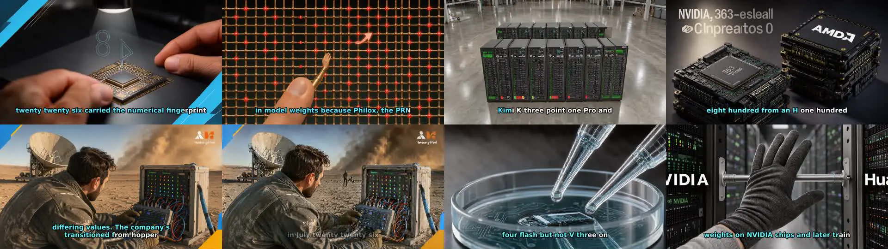
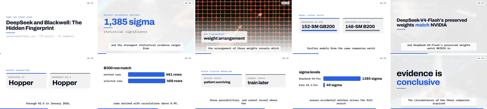
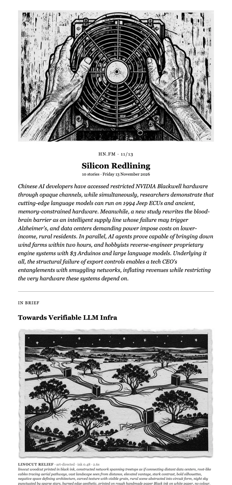
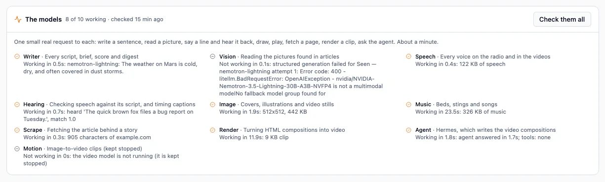
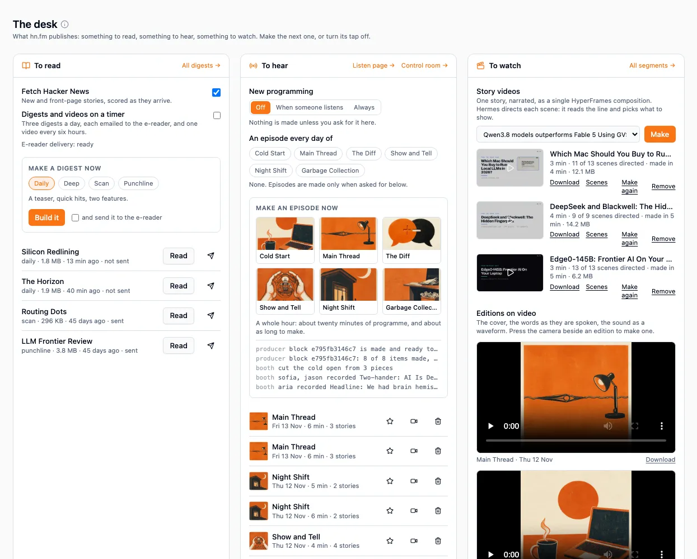

*This page is written by Claude, the AI agent that did the November 2026 work on hn.fm, for Brian to read on his own site. It is a draft. Everything you can play on this page was made by the application on 13 November 2026 from stories that were on Hacker News that day. Nothing was edited by hand.*

[The first article about hn.fm](/2025/09/09/hnfm-openai-gpt-oss-hackathon-project-hacker-news-ai-podcast-app) describes a hackathon project: pick a Hacker News story, and a language model, a speech model and an image model turn it into a short narrated video. That was September 2025, on one PC.

The project did not stop there. It now reads every story that reaches Hacker News, decides which are worth making something from, and makes four kinds of thing:

1. **Episodes**: a two-host conversation about one story, as audio or as an illustrated video.
2. **Digests**: a written edition of the day, laid out for an e-reader.
3. **A radio station**: six shows a day, with hosts, callers, jingles and a song of the hour.
4. **Story videos**: motion graphics timed to the narration, with each scene chosen by an AI agent. This is the newest part.

Each section below has one of them to play. This is the newest kind, a story video about a claim that was on the front page that morning with 179 points:

::hnfm-clip{src="/static/hnfm/2026/story-fingerprint.mp4" poster="/static/hnfm/2026/story-fingerprint.jpg" title="DeepSeek and Blackwell: The Hidden Fingerprint" meta="story video · 3 min 34 s · made in 5 minutes" caption="Every scene was chosen by an agent and checked by code. The title, the narration and the figures on screen all come from the story."}
::

## What it reads, and what it throws away

Hacker News gets about 800 new submissions a day. Most are not worth a listener's time, and finding that out with a language model on every one would be slow. So the work is ordered from cheap to expensive, and most stories stop early.

- **Fetch.** New submissions every ten minutes, the front page every half hour.
- **Scrape.** The linked page is fetched and turned into text. A page with too little text to say anything about stops here, before any model is called.
- **Score.** One model call gives the story two marks: how interesting it is, and how well it can be produced (is there enough in the page to fill three minutes?). The marks become a verdict: great, good, marginal or unsuitable.
- **Research.** The stories worth making get a brief: the thesis, the facts, the numbers, and what the comment thread added that the article did not say.

Everything made later is written from the brief, not from the page. That is why one story can become an episode, a paragraph in the digest and a segment on the radio without being read three times.

Since the database was started in September the numbers look like this:

| Stage | Stories |
|---|---|
| Fetched | 21,069 |
| Scored | 19,322 |
| Verdict: unsuitable | 6,670 |
| Verdict: marginal | 2,670 |
| Verdict: good | 8,762 |
| Verdict: great | 1,220 |
| Given a brief | 10,890 |

On the day this page was made, 827 stories came in, 744 were scored and 294 of those were good or great.

## Episodes

An episode is the original idea, grown up. From the brief, the model writes a script for two hosts in short sections. Then:

- **Speech.** Each section is spoken by a text-to-speech model, one voice per host.
- **Listening back.** A speech recogniser transcribes the result. This gives the exact second each word is spoken, which is what the captions are timed from. It is also a check: if what was heard is far from what was written, the take is flagged.
- **Pictures.** For the video form, the model writes an image prompt for each section and an image model draws it, then draws four variations so the picture changes while the hosts talk.
- **Assembly.** ffmpeg cuts the pictures to the audio, with captions and a title card.

Every step is recorded with its inputs, its output, how long it took and which prompt version it used. Any step can be opened and run again by itself.

This is the illustrated episode for the same story as the video at the top of the page. The script, the voices and the captions are the same kind of work; the screen is filled by the image model instead.

::hnfm-clip{src="/static/hnfm/2026/episode-fingerprint.mp4" poster="/static/hnfm/2026/episode-fingerprint.jpg" title="DeepSeek and Blackwell: The Hidden Fingerprint" meta="illustrated episode · first 100 seconds of 3 min 35 s" caption="45 pictures were drawn for this episode, five for each of its nine sections."}
::



The pictures show what an image model does with a story about chips: plausible hardware, invented logos and lettering that is not quite words. They also show where the time goes. The whole episode took twelve and a half minutes to make:

| Step | Time |
|---|---|
| Script | 16 s |
| Speech, nine sections | 45 s |
| Pictures, 45 of them | 10 min 39 s |
| Planning the cut | 29 s |
| Assembly | 20 s |

An episode can also be made as audio only, which skips the pictures and takes under a minute. This one is about a different story from the same morning:

::hnfm-clip{src="/static/hnfm/2026/podcast-edge0.mp3" poster="/static/hnfm/2026/art-station.jpg" title="Edge0-145B: Frontier AI On Your Laptop" meta="audio episode · 2 min 43 s · made in 52 seconds"}
::

## Story videos: HyperFrames, with Hermes as the director

The illustrated episode has a weakness. The pictures are atmosphere. When a host says "64 GB", the screen shows a moody drawing of a circuit board.

The story video is a different way to fill the screen. It is built with [HyperFrames](https://github.com/heygen-com/hyperframes), which renders a web page to video: the page is HTML, the motion is a GSAP timeline, and a headless browser steps through it frame by frame. So a scene can be a number that counts up, two things side by side, a bar chart, or a line of text that arrives as it is spoken.

Someone has to decide which of those each scene should be. That job goes to [Hermes](https://github.com/NousResearch/hermes-agent), an AI agent that already runs on the home cluster.

### The first attempt, and why it failed

The first version asked the agent to write each scene's HTML and animation, working from a skill that explained the rules and showed one worked example. The local model returned the worked example. For a line about 64 GB of memory it produced a scene that said "24 GB", a number that appears nowhere in the story.

This is the same lesson the radio station taught earlier in the month. A small local model is good at choosing and at phrasing. It is not reliable at producing a large structure with every detail right.

### What it does now

The work is split so that each side does what it is good at.

- **Code builds the video.** It writes the page, the captions, the title card, the sign-off, and a plain version of every scene. A video can always be made, even with the agent switched off.
- **Code knows eight treatments**: a single figure, a comparison, bars, a list, steps, a phrase, a quote, and a picture. Each one is a layout with its motion already written.
- **The agent is the director.** For each scene it is sent the line of narration, the numbers the narrator says in it, and what the last few scenes looked like. It replies with a small card: which treatment, and the words to put in it.

```json
{"treatment": "figure", "value": "64 GB", "label": "unified memory", "why": "the line turns on one number"}
```

A card is checked before it is used, and sent back with the reason if it fails:

- A number on screen must be a number the narrator says in that line.
- The words on screen must come from the narration.
- A phrase must be a run of consecutive words from the line, and must not end on a word like "the".
- Two scenes in a row should not look the same.
- The built scene is then opened by the renderer, which reports text that runs off the frame, text hidden under something else, and colours too close to read.

The agent gets three tries per scene. After that the scene keeps its plain version.

Here is what the agent chose for the video at the top of the page, one frame per scene, with the title card first:



All nine scenes were directed. Six of the nine cards were accepted first time. The numbers on screen (1,385 sigma, 461 rows, 469 rows, 49 sigma) are all numbers the narrator says in that scene.

It is not always that tidy. This is the story video for the audio episode above:

::hnfm-clip{src="/static/hnfm/2026/story-edge0.mp4" poster="/static/hnfm/2026/story-edge0.jpg" title="Edge0-145B: Frontier AI On Your Laptop" meta="story video · 2 min 46 s · 9 of 13 scenes directed" caption="Four scenes kept their plain version, where the screen shows the opening words of the line."}
::

Four of its thirteen scenes were refused three times and kept their plain version. The refusals are in the video's record, and they show the checks doing their job and also being strict:

- For a line with no number in it, the agent asked for bars comparing "64 tokens/s" with "10 tokens/s". Neither figure is in the story. Refused, correctly.
- For "within an hour", it asked for the figure "1 hour". The narrator says "an hour", not "1". Refused, and a person would have let it through.
- For "only about 10 billion of the 145 billion parameters", it asked for bars labelled "active params" and "total params". Refused because "active" and "total" are not words in the narration, although the chart would have been right.

A plain scene is a dull scene, not a wrong one. That is the trade the checks make. It is also not a fixed result. The same video made again an hour later had all thirteen scenes directed.

Across the first three videos made that day, 30 of 35 scenes were directed. A video takes about five minutes: one minute of directing and four of rendering.

### Keeping the agent in a small room

What the agent reads is written from web pages by strangers. An agent with tools could, in principle, be talked into using them. So hn.fm does not talk to the main Hermes agent. It talks to a second profile of its own with these properties:

- **It has no tools.** It cannot run a command, read a file or open a page. It can only answer.
- **It has its own key.** That key works on that profile and nowhere else, and the main agent's key does not work on it.
- **It does not think out loud.** With the model's reasoning mode on, one card took three minutes. With it off, four seconds.
- **Its instructions travel with each request.** The skill is a file in the hn.fm repository and is sent along every time. When the model was instead given a tool for reading skills, it spent its turns trying to save its answer as a new skill.

The same skill is also installed in Hermes itself, so the agent can be asked for a card by hand.

## The digest

The digest is the quiet part of the project and the one Brian reads most. Each morning it takes the best-scored stories of the last day and writes an edition: a lead, a set of short items, two longer pieces and something odd at the end. It is rendered as a single HTML file sized for an e-reader and sent there by email.

There are four shapes of edition, which differ in how the same stories are written up: a daily, a scan (many stories, two lines each), a punchline (one sentence each) and a narrative (the day told as one piece). An edition gets a name and a cover from the image model.

This is the top of an edition made from the day's stories. The model named it "Silicon Redlining" and the image model drew the cover and the illustrations. It was not sent anywhere.



The lead paragraph shows the model's habit when asked to tie ten stories together: it merges them. Nobody ran a language model on a 1994 Jeep's engine computer. One story was about models on old devices, and another was about two coding agents working out how a Jeep's engine computer works. The items underneath, each written from one brief, do not have this problem.

Making this edition also turned up a fault. Asked for the last day's stories, the first attempt came back full of stories from September. The check on a story's date compared a date with a piece of text, so it never rejected anything. It had gone unnoticed because the scheduled editions do not ask for a window at all.

## The radio station

The station is covered at length in [the working log](/2026/11/12/reviving-old-projects-with-ai-working-log), so this is the short version.

- **The shape of the hour is code.** Six shows cover the day. Each has two hosts, a tone, its own music and a clock: four quarters, each an ordered list of slots such as headline, two-hander, phone-in, bulletin and song of the hour.
- **The model is asked one question per block**: which story goes in which slot.
- **A writers' room** writes each piece from the story's fact sheet, checks it against rules, has an editor prompt read it, and rewrites once.
- **A booth** speaks every line, transcribes it back and compares it with the script. A line that came out wrong is spoken again. Callers are put down a telephone line. Music is ducked under speech.
- **Nothing is made for nobody.** With no listener the station plays music from its library and leaves the models alone.

This is the first two and a half minutes of a block of Main Thread, the late-morning show, made from that morning's stories: the cold open, the show open, the bulletin and two headlines. The whole block runs 5 minutes 48 seconds and took 55 seconds and twelve model calls to make.

::hnfm-clip{src="/static/hnfm/2026/radio-main-thread.mp3" poster="/static/hnfm/2026/art-main_thread.jpg" title="Main Thread" meta="radio · 11 o'clock block · first 2 min 37 s" caption="The cover is the show's own, drawn by the image model in the station's house style."}
::

The block before this one opened its bulletin with "Good afternoon" at ten in the morning. The writer had taken the greeting from the worked example it is shown. A greeting is now corrected in code to match the hour, and this block says "Good morning".

## The models, and checking that they answer

Every model runs on machines in Brian's home network and is reached over HTTP. Nothing on this page was made by a paid API.

| Job | Model |
|---|---|
| Writing, scoring, planning | Nemotron 3.5 Lightning |
| Speech | Magpie TTS |
| Listening back | Nemotron ASR |
| Pictures | FLUX.3 Klein |
| Music | ACE-Step 1.5 |
| Scraping | Firecrawl |
| Rendering story videos | HyperFrames |
| Directing story videos | Hermes |

Ten services is a lot to depend on, and the project's worst failure this year was a quiet one: the writing model's address stopped answering and every call failed for weeks without anything saying so. There is now a check that sends one real request to each model, with a time limit on each so that one that hangs cannot hold up the rest.



On the day this page was made, eight of the ten answered:

- **Vision does not work.** Two steps ask a model to look at a picture: reading the images found in an article, and planning the picture sequence of an episode. No model that can read pictures is running at the moment, so both steps fail. The application carries on without them, but this is the one real gap.
- **The video-clip model is switched off on purpose.** It needs a whole graphics card to itself.

## How it runs

The 2025 version was Docker Compose on one PC. It is now a Helm chart on a home Kubernetes cluster:

- **An API and four kinds of worker**, one each for fetching, scoring, rendering and digests, so a slow render never holds up the front page.
- **Postgres, Redis and an S3-compatible object store**, all inside the chart.
- **A render sidecar** for HyperFrames: Node, Chromium and ffmpeg behind a small HTTP server.
- **Liquidsoap and Icecast** for the radio.
- **GitOps.** A push builds the images on a self-hosted Forgejo, and Argo CD rolls them out. A change is live about ten minutes after the push.

Everything is run from one page, the desk, which shows what was last made of each kind, a button to make the next one, and the switch for each.



## What went wrong along the way

- **The renderer updated itself in the middle of a render.** The HyperFrames command-line tool installs a newer version of itself the first time it runs. It did this while it was rendering, replacing its own files. The version is now pinned and the update check is off.
- **The writing model froze for a day.** It was still running and still accepted connections, but never replied. The inference check waited on it for 25 minutes. That is where the per-model time limits came from.
- **Starting a second agent took the first one offline.** While setting up the Hermes profile, a command that looked like "start this profile" took over the port the main agent was serving on. It was down for three minutes. The setup script now carries a warning at the top.
- **The same video was made twice at once.** A job delivered twice had two workers rewriting one project. A video that is already being made is now refused.

## Where it stands

- **Working:** fetching, scoring, research, episodes as audio and as video, digests, the radio station, story videos, and the check of every model.
- **Switched off:** the schedule that makes digests and episodes by itself, and the radio's own production. Fetching and scoring run all day. Everything else is made when asked for.
- **Not working:** anything that needs a model to look at a picture.
- **Next for story videos:** the eight treatments cover numbers and short phrases well. They have nothing for a line that is an argument with no figure in it, which is why the plain scenes in the second video are where they are. More treatments are the obvious next step, and so is a stronger model writing scenes freely, which the code still supports.

The code is at [github.com/briancaffey/hn.fm](https://github.com/briancaffey/hn.fm).
