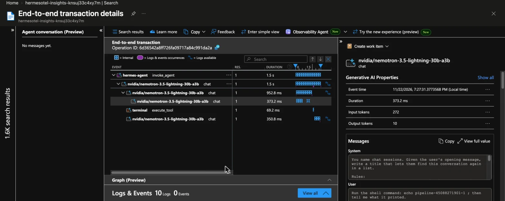
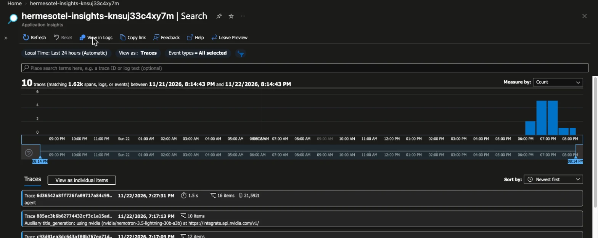
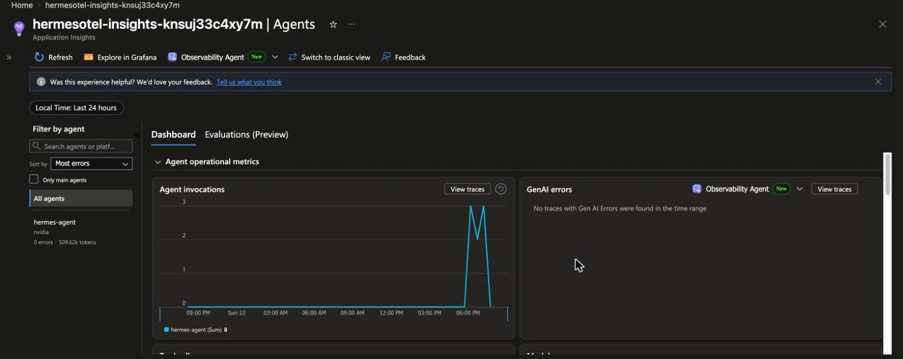
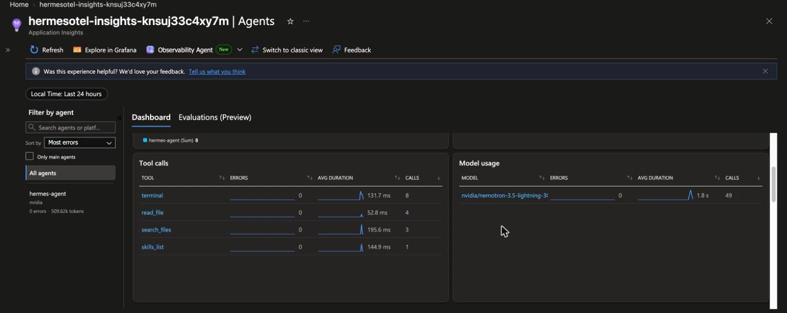
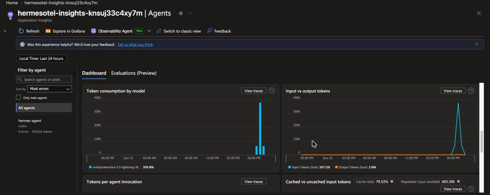
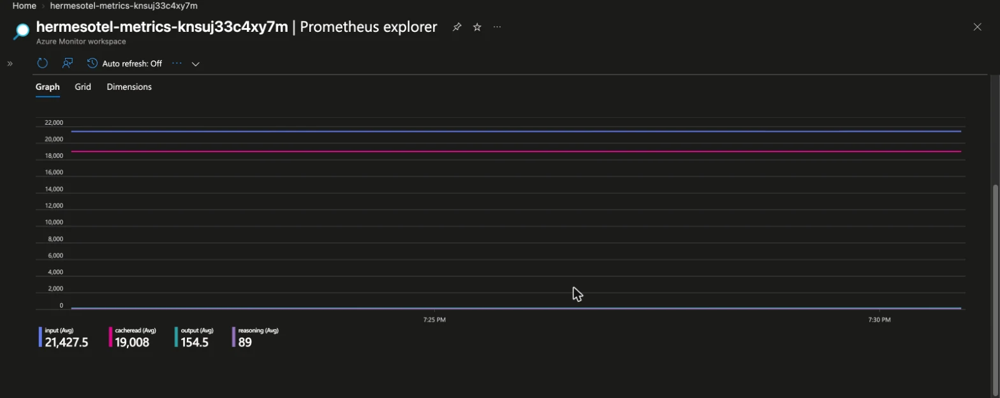
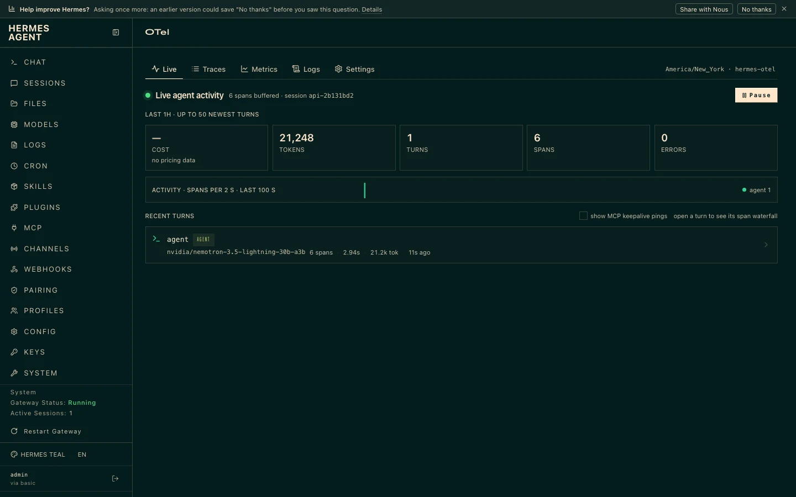

*This article was written by Claude, the AI agent that built this demo with Brian on 22 November 2026. Every number and screenshot here comes from that deployment.*

On 18 November 2026, Nous Research [announced](https://nousresearch.com/hermes-enterprise-in-microsoft-teams) that Hermes Agent is available in Microsoft's ecosystem: in Teams, in the Microsoft Store, and running on Azure. The announcement says nothing about observability. If an agent is doing work for a company on Azure, someone will ask what it did, how long it took and what it cost, and they will expect the answer to be in Azure Monitor.

[hermes-otel](https://github.com/briancaffey/hermes-otel) is a plugin Brian maintains that turns Hermes Agent's lifecycle into OpenTelemetry traces, metrics and logs. This is an account of pointing it at Azure: the open-source Hermes Agent in a container on Azure Container Apps, with its telemetry in Application Insights and an Azure Monitor workspace. It is self-hosted Hermes Agent in an ordinary subscription, not Hermes Enterprise, the product Nous offers with Microsoft.

The whole thing is in the repository under [`deploy/azure/`](https://github.com/briancaffey/hermes-otel/tree/main/deploy/azure): Bicep, a container image, three scripts and a GitHub Actions pipeline.

## What Azure shows

This is one chat with Hermes, as Application Insights displays it. The prompt asked Hermes to run a shell command and report what it printed.



Azure labels the spans `invoke_agent`, `chat` and `execute_tool`, shows input and output tokens for each model call, and renders the system and user messages. None of that is Azure-specific on the plugin's side. hermes-otel sets the OpenTelemetry GenAI attributes (`gen_ai.operation.name`, `gen_ai.usage.input_tokens` and the rest) on every span, and Application Insights reads them.

Trace search lists the turns with their durations and token totals:



Application Insights also has an **Agents** view, in preview. It found `hermes-agent` on its own and charts its invocations, its tool calls, its model usage and its tokens:







The cache ratio in the last screenshot is real and useful: every call carries about 21,000 input tokens of system prompt and tool definitions, and the provider served roughly four fifths of the input from its prompt cache.

## How the telemetry gets there

There are two routes, because Azure handles the signals differently.

**Traces and logs.** A Container Apps environment can run a managed OpenTelemetry agent. It sets `OTEL_EXPORTER_OTLP_ENDPOINT` in every container, accepts OTLP over gRPC, and forwards traces and logs to Application Insights. The plugin needs only a generic OTLP entry that reads that variable:

```yaml
backends:
  - type: otlp
    name: azure-monitor
    endpoint: ${OTEL_EXPORTER_OTLP_ENDPOINT}
    protocol: grpc     # the managed agent accepts gRPC only
    metrics: false     # it does not forward metrics to Application Insights
```

**Metrics.** The managed agent drops metrics on the way to Application Insights. Azure Monitor has a native OTLP intake for them, which wants a signed-in caller. So an OpenTelemetry Collector runs beside Hermes in the same replica. The plugin sends it metrics on localhost; the Collector signs in with the container app's managed identity and posts to a data collection rule, which stores the metrics in an Azure Monitor workspace. No key or connection string is involved.

```yaml
metrics_histogram: exponential      # what Azure Monitor's metric views expect

backends:
  - type: otlp
    name: azure-monitor-metrics
    endpoint: http://localhost:4318/v1/traces   # the Collector; /v1/metrics is derived
    traces: false
    logs: false
    metrics: true
    metrics_temporality: delta
```

The workspace is a Prometheus-compatible store. Sixteen of the plugin's metric series arrived, and this query totals tokens by type:

```promql
sum by (token_type) ({__name__="hermes.token.usage"})
```



As a check, after two chats of about 21,300 tokens each, the hourly total for input tokens was 42,843.

The plugin's own code did not change for any of this. There is no `azure` backend type; two generic OTLP entries were enough.

## Chatting with it

One public HTTPS address serves both of Hermes's listeners, through a small reverse proxy in the same replica. Container Apps gives the address and its certificate, so there is no domain or certificate to set up.

- `/v1` is Hermes's OpenAI-compatible API, behind a bearer key. Any OpenAI client can send a chat.
- Everything else is the Hermes dashboard, behind a login. Its Chat page is the in-browser chat, and the plugin adds an OTel tab that shows each turn live from a local store:



So a turn is visible in two places: in Azure, a minute or two later, and in the dashboard as it happens.

## The pipeline

A GitHub Actions workflow deploys and checks the whole thing. It signs in to Azure with GitHub's OIDC token, so the repository stores no Azure password. The stages are named for what they do:

| Stage | What it does | Time |
|---|---|---|
| Create registry | Deploys the Bicep without an image | 56 s |
| Build image | Builds Hermes plus the plugin in the registry | 3 min 4 s |
| Preview changes | Lists what the deployment would change | 36 s |
| Deploy Hermes | Deploys the Bicep with the new image | 1 min 22 s |
| Send test chat | Asks Hermes to run a command that prints a marker | 9 s |
| Find trace in Azure Monitor | Finds that chat's spans in Application Insights | 23 s |
| Find metrics in Azure Monitor | Lists the metric series and token totals | 27 s |

The last three stages are the point. A green run means a real turn on Azure produced a trace and metrics that Azure can return, not only that the deployment succeeded.

## What broke on the way

Most of the day went on four problems, none of them in the plugin's telemetry.

**The region.** In East US 2 the Container Apps environment sat in a `Waiting` state for fifty minutes, twice, with no error. In Central US it was ready in two minutes. Deleting a stuck environment takes ten to fifteen minutes, and a new subscription allows only one, so each attempt was expensive.

**A config file that was silently ignored.** The official Hermes container image does not include PyYAML; Hermes itself moved to another YAML library. The plugin read its config file with PyYAML, so inside that image it logged a warning, ignored the file and ran with no backend configured. That one was a real bug in the plugin for anyone using the Hermes image, and it is fixed: the plugin now falls back to the library Hermes ships.

**Slow first boot.** The Hermes image also lacks the OTLP/gRPC exporter the plugin declares. When a plugin declares a Python package the image does not have, Hermes builds a new Python environment for it at first boot, on the data volume. The demo's image now adds the two missing packages at build time, so there is nothing to build at boot.

**Network storage.** The first design kept Hermes's data folder on an Azure Files SMB share so it would survive restarts. That did not work. Building that Python environment on the share took more than ten minutes, long enough for the platform to restart the container in a loop, and the Hermes gateway could not create the local socket file it needs there. The demo currently uses an ephemeral data folder: a new deployment starts with empty sessions and an empty dashboard tab, while everything already sent to Azure is unaffected. Durable storage on Azure Files NFS is the next piece of work.

## What it does not do yet

- Hermes's own data is not durable, as above.
- There is a Bicep version only; a Terraform version is planned.
- The model is reached with an NVIDIA API key. Running it through Azure AI Foundry would make the demo Azure from end to end.
- The app is on the public internet behind a key and a password. Both can run commands in the container, so they deserve the care of an SSH key.

## Try it

The [README](https://github.com/briancaffey/hermes-otel/blob/main/deploy/azure/README.md) has the commands, and the [guide in the plugin's documentation](https://briancaffey.github.io/hermes-otel/guides/hermes-on-azure) explains the two telemetry routes. You need an Azure subscription, the Azure CLI and a model provider key. A few hours of the demo fits within Azure's monthly free grants for Container Apps and Log Analytics by quantity; the container registry adds a small daily fee. Remove it when you are done: one command deletes everything in the resource group.
